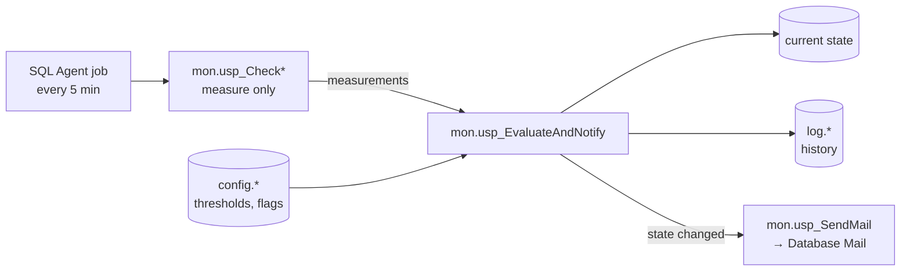

# safetica-alerting

Lightweight, T-SQL–only alerting package for SQL Server instances hosting Safetica databases.
Built as an add-on service for **Safetica Gold Support** customers.

> **Status:** 🚧 Early development — nothing here is production-ready yet. Structure, names and defaults may change.

---

## What it does

Periodically measures the health of the SQL Server instance and its databases, keeps a short history, and sends an e-mail via Database Mail **only when a state changes** (no alert spam every 5 minutes).

| Check | What it watches | Status |
|---|---|---|
| Log file | Used log space vs. MAXSIZE, or size / `log_reuse_wait_desc` for unlimited logs | Planned (v0.1) |
| Disk space | Free space on every volume holding database files (`sys.dm_os_volume_stats`) | Planned |
| Data file size | Total size of data files per database vs. configured `MaxSize` × `PctTrigger` (e.g. 100 GB × 85 % → alert at 85 GB) | Planned |
| TempDB | Usage of pre-sized TempDB, or size growth when not pre-sized | Planned |
| Heartbeat | Periodic "all checks running" summary mail | Planned |

Backup checks (backup freshness, last good CHECKDB, corruption alerts 823/824/825) are candidates for a later phase — see [Roadmap](#roadmap).

## Design principles

- **Pure T-SQL, no extra services.** Everything runs as SQL Agent jobs and stored procedures. No agents, no CLR, no `xp_cmdshell`, no external binaries.
- **Separate database.** All objects live in a dedicated `safetica_alerting` database — never in `safetica_data` or other product databases.
- **Read-only towards customer data.** Checks read DMVs and metadata only. The package never changes customer database settings (e.g. MAXSIZE, recovery model).
- **Everything configurable.** Thresholds, recipients, enabled checks and retention live in config tables.
- **Re-runnable deployment.** One deploy script handles both clean install and upgrade; running it twice is safe.

## Key decisions

Full reasoning, alternatives and status of every decision: **[docs/decisions.md](docs/decisions.md)**.

| Area | Decision |
|---|---|
| Database | Own DB `safetica_alerting`, outside the product DACPAC, `SIMPLE` recovery, not backed up |
| Config | Per-check enable flag and thresholds; upgrades never overwrite customer config |
| Alerts | Mail only on state change, cleared mail on return to OK, hysteresis against flapping |
| Log file | Used space vs. MAXSIZE; fallback for unlimited logs; MAXSIZE is recommended, never enforced |
| Database Mail | Separate deployment, own profile, connectivity test, English-only templates |
| Retention | Batched deletes, restricted to own DB, minimum 1 day, UTC timestamps |

**Open questions:** Agent job owner (`sa` vs. dedicated login), job failure notification, config backup approach.

## Architecture



Checks only **measure**. A single shared engine evaluates thresholds, applies hysteresis, compares with the previous state and decides whether to send a mail. A new check means a new measuring procedure plus config rows — the alerting logic is written and tested once.

### Database

| | |
|---|---|
| Name | `safetica_alerting` |
| Recovery model | `SIMPLE` |
| Compatibility level | `150` (SQL Server 2019) on all versions |
| Backups | Not required — config is reproducible from the deploy script; history is disposable |

### Schemas

| Schema | Contents |
|---|---|
| `config` | Settings, per-check thresholds and enable flags, schema version |
| `log` | Measurement and state history (subject to retention) |
| `mon` | Check procedures, evaluation engine, mail wrapper, retention |

## Alert behaviour

- States: **OK → Warning → Critical**.
- A mail is sent when a state **worsens** (OK→Warning, OK→Critical, Warning→Critical).
- A **cleared** mail is sent when a check returns to OK (can be disabled per check).
- Improvements that stay in a bad state (Critical→Warning) do not send a mail.
- **Hysteresis** prevents flapping around a threshold (e.g. Warning below 15 % free, back to OK only above 17 %).
- Every mail contains the server name, affected object, measured value, threshold and package version.

## Requirements

| Requirement | Notes |
|---|---|
| SQL Server 2019, 2022 or 2025 | Standard or Enterprise edition (Developer for testing). **Express is not supported** (no SQL Agent). |
| SQL Server Agent | Running |
| Database Mail | Enabled (`Database Mail XPs`); the package creates its own mail profile |
| SMTP relay | Reachable from the SQL Server host |
| Permissions | `sysadmin` for deployment |

## Repository layout

```
├─ docs/
│  └─ decisions.md        Design decisions and their reasoning
├─ migrations/            Tables, schemas, config seed — applied once, numbered
├─ programmability/       Procedures (CREATE OR ALTER) — redeployed every time
│  ├─ engine/
│  ├─ checks/
│  └─ maintenance/
├─ deploy/
│  ├─ build.ps1           Builds a single deploy_<version>.sql
│  ├─ dbmail_setup.sql    Database Mail profile setup (deployed separately)
│  └─ uninstall.sql
└─ tests/                 tSQLt unit tests and deployment tests (never deployed)
```

## Deployment

> Not available yet. The intended flow:

1. Run `dbmail_setup.sql` (once) — creates the mail profile and sends a test mail.
2. Open `deploy_<version>.sql` in SSMS (SQLCMD mode), review the variables at the top, run.
3. Adjust thresholds and recipients in the `config` tables if defaults don't fit.

Upgrading = running the deploy script of the newer version. Customer configuration is preserved.

## Versioning

- Package versions follow [SemVer](https://semver.org/) (`MAJOR.MINOR.PATCH`), tagged as `vX.Y.Z`.
- Schema changes are numbered migrations; applied migrations are recorded in `config.SchemaVersion`.
- Procedures are redeployed with `CREATE OR ALTER` on every deployment.
- No downgrade scripts — fixes roll forward.

## Testing

- **Unit tests** of the engine with [tSQLt](https://tsqlt.org/) (dev/test environments only — never deployed to customers).
- **Integration tests** with real scenarios (growing log, filling a test volume) and a local SMTP catcher.
- **Deployment tests:** clean install, idempotent re-run, upgrade from every previous version, config preservation, uninstall.
- **Version matrix:** SQL Server 2019 / 2022 / 2025.

## Roadmap

| Version | Scope |
|---|---|
| v0.1 | Foundation (DB, schemas, versioning, deploy guard), engine, log file check, retention |
| v0.x | Disk space, data file size, TempDB checks, heartbeat, uninstall |
| v1.0 | Test matrix green on 2019/2022/2025, customer documentation |
| Later | Backup freshness, last good CHECKDB, corruption alerts (823/824/825) |

**Out of scope:** index/statistics maintenance, automated restore tests, Availability Group–aware monitoring, SQL Server Express.